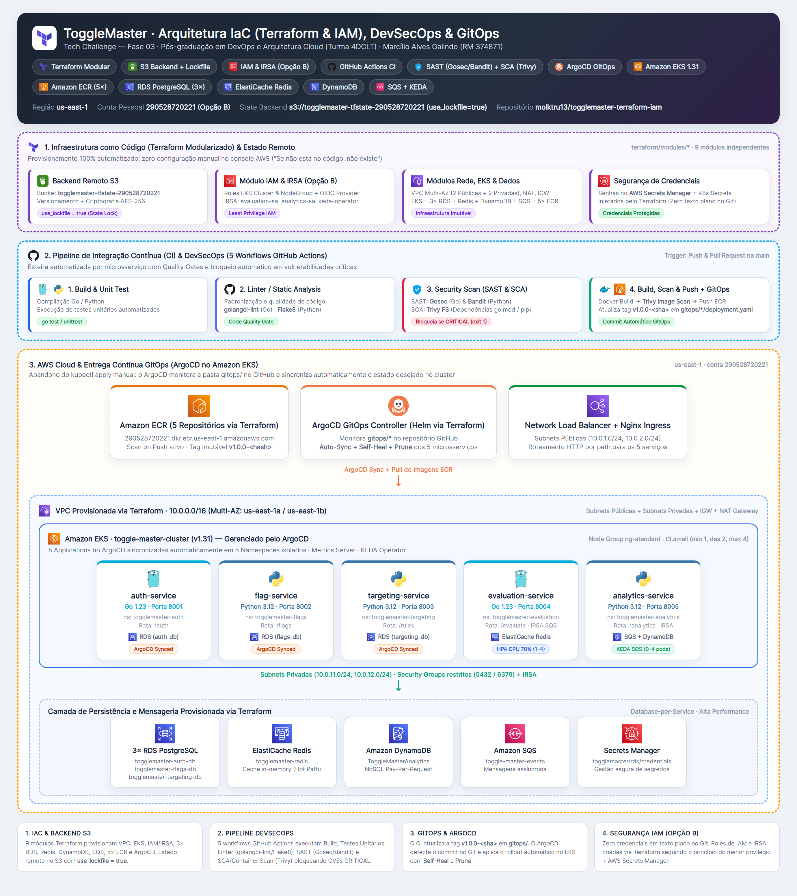

<div align="center">

# Relatório de Entrega — Tech Challenge Fase 3

**Projeto:** ToggleMaster — Terraform & IAM  
**Curso:** Pós-graduação em DevOps e Arquitetura Cloud  
**Turma:** 4DCLT  
**Fase:** 03  

---

## 👥 Participantes

| Nome | RM | E-mail |
|---|---|---|
| Marcílio Alves Galindo | 374871 | marcilio@workmail.com |

---

# ToggleMaster — IaC, DevSecOps & GitOps

**Infraestrutura Imutável com Terraform & IAM | Pipelines DevSecOps | Entrega Contínua com ArgoCD no Amazon EKS**

[](https://www.terraform.io)
[](https://aws.amazon.com/iam/)
[](https://aws.amazon.com/eks/)
[](https://github.com/features/actions)
[](https://trivy.dev)
[](https://argo-cd.readthedocs.io)
[](https://go.dev)
[](https://www.python.org)

</div>

---

## 📋 Sobre o Projeto e Contexto do Desafio

Na **Fase 2**, a **DevOps Solutions Inc.** aprovou a arquitetura distribuída de 5 microsserviços do **ToggleMaster** no Amazon EKS. Porém, a operação manual tornou-se insustentável:
- Desenvolvedores executavam `kubectl apply` de máquinas locais, gerando **conflitos de versão** e *configuration drift*.
- Credenciais de banco de dados trafegavam em arquivos de texto sem governança.
- Uma **vulnerabilidade crítica em uma biblioteca Go** (`golang.org/x/crypto` — `CVE-2024-45337`) passou despercebida para produção.
- Recriar o ambiente levava dias por ter sido provisionado manualmente via console.

> **A ordem na Fase 3 é:** *"Se não está no código, não existe"*.  
> Este projeto automatiza **100% da infraestrutura na AWS via Terraform modularizado (Opção B: Conta Pessoal com IAM & IRSA)**, implementa **5 esteiras de CI & DevSecOps no GitHub Actions** com bloqueio automático de vulnerabilidades críticas (SAST, SCA e Container Scan) e adota **Entrega Contínua (CD) via GitOps com ArgoCD**.

---

## 🏗️ Arquitetura da Fase 3 (IaC + DevSecOps + GitOps)



---

## 🧬 Ecossistema de Microsserviços

| Microsserviço | Linguagem | Porta | Namespace | Data Store | Papel na Arquitetura | Escalabilidade & GitOps |
|---|---|---|---|---|---|---|
| `auth-service` | Go 1.23 | `8001` | `togglemaster-auth` | RDS PostgreSQL (`auth_db`) | Emissão e validação de chaves de API (SHA-256) | ArgoCD Auto-Sync |
| `flag-service` | Python 3.12 | `8002` | `togglemaster-flags` | RDS PostgreSQL (`flags_db`) | CRUD de definições de Feature Flags | ArgoCD Auto-Sync |
| `targeting-service` | Python 3.12 | `8003` | `togglemaster-targeting` | RDS PostgreSQL (`targeting_db`) | Regras de segmentação (JSONB / Percentage) | ArgoCD Auto-Sync |
| `evaluation-service` | Go 1.23 | `8004` | `togglemaster-evaluation` | ElastiCache Redis + SQS | *Hot Path* de decisão em milissegundos | **HPA** (CPU 70%, 1–4 pods) + ArgoCD |
| `analytics-service` | Python 3.12 | `8005` | `togglemaster-analytics` | SQS + DynamoDB | Worker de eventos assíncronos e métricas | **KEDA** (Fila SQS, 0–4 pods) + ArgoCD |

---

## 🔗 Repositórios

- **Repositório Fase 3 (Terraform, IAM, DevSecOps & GitOps):** [https://github.com/molktru13/togglemaster-terraform-iam](https://github.com/molktru13/togglemaster-terraform-iam)
- **Repositório Fase 2 (Referência anterior):** [https://github.com/molktru13/togglemaster-microservicos](https://github.com/molktru13/togglemaster-microservicos)

---

## ✅ Requisitos Técnicos Atendidos

### 1. Infraestrutura como Código (Terraform Modularizado + IAM — Opção B: Conta Pessoal)

Toda a infraestrutura manual da Fase 2 foi substituída por código **Terraform** organizado em **9 módulos reutilizáveis** (`terraform/modules/`), seguindo a **Opção B (Conta Pessoal)** e priorizando o Terraform inclusive nos itens opcionais:

| Módulo Terraform | Caminho | Recursos Provisionados |
|---|---|---|
| **Bootstrap S3** | `terraform/bootstrap` | Bucket S3 `togglemaster-tfstate-290528720221` com **Versionamento**, **Criptografia AES-256** e Public Access Block para o Backend Remoto. |
| **Backend Remoto** | `terraform/backend.tf` | Armazena `fase3/terraform.tfstate` no S3 com **`use_lockfile = true`** (State Locking nativo do S3). |
| **Networking** | `terraform/modules/networking` | VPC `10.0.0.0/16`, 2 Subnets Públicas (`10.0.1.0/24`, `10.0.2.0/24`), 2 Subnets Privadas (`10.0.11.0/24`, `10.0.12.0/24`) em `us-east-1a`/`1b`, Internet Gateway, NAT Gateway com EIP, Route Tables e Security Groups dedicados (`5432` para RDS e `6379` para Redis). |
| **IAM & IRSA** | `terraform/modules/iam` | **Opção B (Conta Pessoal):** Roles de IAM do Control Plane EKS e Node Group + OIDC Provider + **3 Roles IRSA** com privilégio mínimo (`evaluation-irsa-role`, `analytics-irsa-role`, `keda-irsa-role`). |
| **Cluster EKS** | `terraform/modules/eks` | Cluster Kubernetes `toggle-master-cluster` (v1.31) + Managed Node Group `ng-standard` (`t3.small`, min=1, desejado=2, max=4) + OIDC Provider. |
| **RDS PostgreSQL (3×)** | `terraform/modules/rds` | **3 instâncias RDS PostgreSQL independentes** (`togglemaster-auth-db`, `togglemaster-flags-db`, `togglemaster-targeting-db`), DB Subnet Group e armazenamento seguro de credenciais no **AWS Secrets Manager** (`togglemaster/rds/credentials`). |
| **ElastiCache Redis** | `terraform/modules/redis` | **1 Cluster ElastiCache Redis 7** (`togglemaster-redis`, `cache.t3.micro`) e Cache Subnet Group. |
| **DynamoDB** | `terraform/modules/dynamodb` | **1 Tabela DynamoDB** (`ToggleMasterAnalytics`, `PAY_PER_REQUEST`, chave de partição `event_id` e criptografia SSE). |
| **Mensageria SQS** | `terraform/modules/sqs` | **1 Fila SQS Standard** (`toggle-master-events`) com Long Polling (20s) e criptografia SSE. |
| **Repositórios ECR (5×)** | `terraform/modules/ecr` | **5 Repositórios no Amazon ECR** (`auth-service`, `flag-service`, `targeting-service`, `evaluation-service`, `analytics-service`) com `scan_on_push = true` e Lifecycle Policy. |
| **ArgoCD & Add-ons** | `terraform/modules/argocd` | Instalação via Terraform (`helm_release` e `kubernetes`) do **ArgoCD**, **Nginx Ingress Controller (NLB)**, **Metrics Server**, **KEDA**, Namespaces, ServiceAccounts IRSA, ConfigMaps SQL e **Secrets Kubernetes** injetados diretamente pelo Terraform (zero credenciais em texto plano no Git). |

---

### 2. Pipeline de Integração Contínua (CI) & DevSecOps (GitHub Actions)

Foram criados **5 workflows independentes** em `.github/workflows/` (um para cada microsserviço, mais 1 workflow de validação contínua do Terraform), acionados em cada `push` e `pull_request` na branch `main`:

- [`auth-service-ci.yaml`](.github/workflows/auth-service-ci.yaml) (Go)
- [`flag-service-ci.yaml`](.github/workflows/flag-service-ci.yaml) (Python)
- [`targeting-service-ci.yaml`](.github/workflows/targeting-service-ci.yaml) (Python)
- [`evaluation-service-ci.yaml`](.github/workflows/evaluation-service-ci.yaml) (Go)
- [`analytics-service-ci.yaml`](.github/workflows/analytics-service-ci.yaml) (Python)
- [`terraform-validate.yaml`](.github/workflows/terraform-validate.yaml) (Terraform Format & Validate)

#### Estágios (Jobs) de cada Pipeline:

1. **Estágio 1 — Build & Unit Test:**
   - Compila o código (`go build` / `py_compile`) e executa a suíte de testes unitários automatizados (`go test -v -race ./...` para Go e `python -m unittest discover -v` para Python).
2. **Estágio 2 — Linter / Static Analysis:**
   - Executa `golangci-lint` nos microsserviços em Go (`auth-service`, `evaluation-service`) e `flake8` nos microsserviços em Python (`flag-service`, `targeting-service`, `analytics-service`).
3. **Estágio 3 — Security Scan (SAST & SCA) com Regra de Bloqueio:**
   - **SAST (*Static Application Security Testing*):** Analisa vulnerabilidades no código-fonte com **`gosec`** (Go) e **`bandit`** (Python).
   - **SCA (*Software Composition Analysis*):** Analisa vulnerabilidades nas árvores de dependências (`go.mod`/`go.sum` e `requirements.txt`) usando **`Trivy`** em modo filesystem (`trivy fs --scanners vuln --severity CRITICAL --exit-code 1`).
   - **Regra de Bloqueio:** Caso qualquer vulnerabilidade **CRÍTICA** (ou falha SAST de alta severidade) seja detectada, o job retorna `exit-code: 1`, interrompendo imediatamente o pipeline e impedindo o build/push da imagem.
4. **Estágio 4 — Docker Build, Container Scan, Push ECR & Atualização GitOps:**
   - Constrói a imagem Docker multi-stage.
   - Executa o **Container Scan com Trivy** (`trivy image --severity CRITICAL --exit-code 1`) na imagem recém-construída.
   - Autentica no **Amazon ECR** e publica a imagem com **tag imutável baseada no hash do commit** (`v1.0.0-<short_sha>`, ex: `v1.0.0-a1b2c3d`) além de `latest`.
   - Atualiza automaticamente o manifesto `gitops/<service>/deployment.yaml` com a nova tag gerada e realiza o commit/push (`[skip ci]`) no repositório.

---

### 3. Entrega Contínua (CD) & GitOps com ArgoCD

Abandonamos completamente o `kubectl apply` manual ou push direto via CI:

1. ** Estrutura GitOps (`gitops/`):**
   - Pasta dedicada contendo os manifestos declarativos de cada microsserviço (`gitops/auth-service`, `gitops/flag-service`, `gitops/targeting-service`, `gitops/evaluation-service`, `gitops/analytics-service`) e as definições das 5 aplicações no ArgoCD (`gitops/argocd/applications.yaml`).
2. **ArgoCD Instalado via Terraform:**
   - Provisionado no namespace `argocd` via provider `helm` do Terraform.
3. **Sincronização Automática (*Auto-Sync*, *Self-Heal* e *Prune*):**
   - As 5 `Application`s do ArgoCD monitoram continuamente a branch `main` deste repositório.
   - Assim que o pipeline de CI faz o commit da nova tag `v1.0.0-<sha>` em `gitops/<service>/deployment.yaml`, o ArgoCD detecta a divergência de estado e executa o *Rolling Update* automático no cluster EKS.
   - Configurado com `RespectIgnoreDifferences=true` em `/spec/replicas` nos serviços `evaluation-service` e `analytics-service` para conviver harmoniosamente com o **HPA** e o **KEDA**.

---

## 📂 Estrutura do Repositório

```text
togglemaster-terraform-iam/
├── .github/
│   └── workflows/                  # 5 Pipelines DevSecOps (Go/Python) + 1 Validação Terraform
│       ├── auth-service-ci.yaml
│       ├── flag-service-ci.yaml
│       ├── targeting-service-ci.yaml
│       ├── evaluation-service-ci.yaml
│       ├── analytics-service-ci.yaml
│       └── terraform-validate.yaml
├── terraform/                      # Infraestrutura como Código (100% Terraform)
│   ├── bootstrap/                  # Criação do Bucket S3 para o Backend Remoto
│   ├── backend.tf                  # Backend S3 com use_lockfile = true
│   ├── providers.tf                # Providers AWS, Kubernetes, Helm e TLS
│   ├── main.tf                     # Orquestração dos 9 módulos
│   ├── variables.tf                # Variáveis parametrizadas
│   ├── outputs.tf                  # Outputs de rede, EKS, RDS, Redis, ECR, IAM e ArgoCD
│   └── modules/
│       ├── networking/             # VPC, Subnets Públicas/Privadas, IGW, NAT, Route Tables, SGs
│       ├── iam/                    # Roles EKS + OIDC Provider + Roles IRSA (Opção B)
│       ├── eks/                    # Cluster EKS 1.31 + Managed Node Group (t3.small)
│       ├── rds/                    # 3× RDS PostgreSQL + AWS Secrets Manager
│       ├── redis/                  # 1× Cluster ElastiCache Redis
│       ├── dynamodb/               # 1× Tabela DynamoDB (ToggleMasterAnalytics)
│       ├── sqs/                    # 1× Fila SQS (toggle-master-events)
│       ├── ecr/                    # 5× Repositórios ECR com Scan on Push
│       └── argocd/                 # ArgoCD, Ingress Nginx, KEDA, Metrics Server e Secrets K8s
├── gitops/                         # Manifestos Kubernetes declarativos monitorados pelo ArgoCD
│   ├── argocd/applications.yaml    # 5 Applications do ArgoCD com Auto-Sync + Self-Heal
│   ├── auth-service/deployment.yaml
│   ├── flag-service/deployment.yaml
│   ├── targeting-service/deployment.yaml
│   ├── evaluation-service/deployment.yaml
│   └── analytics-service/deployment.yaml
├── auth-service/                   # Microsserviço Go (Porta 8001) + Testes Unitários
├── flag-service/                   # Microsserviço Python (Porta 8002) + Testes Unitários
├── targeting-service/              # Microsserviço Python (Porta 8003) + Testes Unitários
├── evaluation-service/             # Microsserviço Go (Porta 8004) + Testes Unitários
├── analytics-service/              # Microsserviço Python (Porta 8005) + Testes Unitários
├── docker-compose.yml              # Ambiente local completo (9 containers)
├── diagrama.png                    # Diagrama de Arquitetura da Fase 3
└── README.md                       # Documentação oficial do projeto
```

---

## 🚀 Como Reproduzir

### 1. Provisionar a Infraestrutura Completa com Terraform

```powershell
# 1.1 (Apenas na 1ª vez) Criar o Bucket S3 do Backend Remoto
cd C:\FIAP\togglemaster-terraform-iam\terraform\bootstrap
terraform init
terraform apply -auto-approve

# 1.2 Inicializar e aplicar os 9 módulos da infraestrutura principal
cd C:\FIAP\togglemaster-terraform-iam\terraform
terraform init
terraform plan
terraform apply -auto-approve
```

### 2. Configurar o `kubectl` e Aplicar as Applications do ArgoCD

```powershell
aws eks update-kubeconfig --name toggle-master-cluster --region us-east-1
kubectl get nodes
kubectl apply -f C:\FIAP\togglemaster-terraform-iam\gitops\argocd\applications.yaml
kubectl get applications -n argocd
```

### 3. Acessar a Interface Web do ArgoCD

```powershell
# Obter a senha inicial do admin do ArgoCD
$argoPass = kubectl -n argocd get secret argocd-initial-admin-secret -o jsonpath="{.data.password}"
[System.Text.Encoding]::UTF8.GetString([System.Convert]::FromBase64String($argoPass))

# Expor a UI do ArgoCD localmente em https://localhost:8080
kubectl port-forward svc/argocd-server -n argocd 8080:80
```

### 4. Testar os Microsserviços via Network Load Balancer (Ingress Nginx)

```powershell
$nlb = (kubectl get svc ingress-nginx-controller -n ingress-nginx -o jsonpath="{.status.loadBalancer.ingress[0].hostname}")
Invoke-RestMethod -Uri "http://$nlb/auth/health"
Invoke-RestMethod -Uri "http://$nlb/flags/health"
Invoke-RestMethod -Uri "http://$nlb/rules/health"
Invoke-RestMethod -Uri "http://$nlb/evaluate/health"
Invoke-RestMethod -Uri "http://$nlb/analytics/health"
```

---

## 🧠 Resumo dos Desafios Encontrados e Decisões Tomadas

1. **Remediação da Vulnerabilidade Crítica em Go (`CVE-2024-45337`) e Dependências Python:**
   - Durante a implantação do estágio **SCA com Trivy**, o scanner identificou imediatamente a vulnerabilidade **CRÍTICA** `CVE-2024-45337` (CVSS 9.1) no pacote `golang.org/x/crypto v0.20.0` do `auth-service`, além de CVEs em versões antigas do `gunicorn` e `Werkzeug` nos serviços Python. Atualizamos o Go para `1.23`, `golang.org/x/crypto` para `v0.36.0`, `golang.org/x/net` para `v0.37.0` e a stack Python para `Python 3.12-slim` com `Flask 3.1.0`, `Werkzeug 3.1.3` e `gunicorn 23.0.0`, zerando as vulnerabilidades críticas.
2. **Adequação do Código ao SAST (`Gosec` e `Bandit`) e Linters (`golangci-lint` e `Flake8`):**
   - O `gosec` apontou `G114` (*Use of net/http serve function that has no support for setting timeouts*) nos serviços Go. Substituímos `http.ListenAndServe` por `http.Server` configurado com `ReadHeaderTimeout: 5 * time.Second`. Também substituímos o pacote depreciado `io/ioutil` por `io.ReadAll`.
3. **Eliminação de Credenciais em Texto Plano no Git (Terraform → Secrets Manager & K8s Secrets):**
   - Para resolver a falha de segurança da Fase 2 onde senhas ficavam em arquivos YAML versionados, o módulo `rds` grava as credenciais no **AWS Secrets Manager** e o módulo `argocd` injeta os `Secret`s diretamente nos namespaces do EKS via provider `kubernetes` do Terraform. Assim, a pasta `gitops/` contém apenas manifestos seguros sem nenhuma credencial exposta.
4. **Convivência entre ArgoCD GitOps e Autoscalers (HPA e KEDA):**
   - Como o KEDA escala o `analytics-service` para `0` réplicas quando a fila SQS está vazia e o HPA escala o `evaluation-service` sob carga de CPU, configuramos `ignoreDifferences` para `/spec/replicas` com `RespectIgnoreDifferences=true` nas `Application`s do ArgoCD, evitando que o Self-Heal do ArgoCD sobrescrevesse o escalonamento dinâmico.
5. **Concorrência de Push nos Workflows GitOps:**
   - Implementamos `git pull --rebase` com retentativa automática na etapa de atualização dos manifestos `gitops/*/deployment.yaml` para garantir que múltiplos pipelines rodando em paralelo não sofram conflito de push na branch `main`.

---

## 🛠️ Stack Tecnológica Completa

| Camada | Tecnologias Utilizadas |
|---|---|
| **Infraestrutura como Código (IaC)** | Terraform 1.11+, Backend Remoto Amazon S3 (`use_lockfile = true`), 9 Módulos Terraform |
| **Identidade e Segurança Cloud** | AWS IAM (Opção B: Conta Pessoal), OIDC Provider, IRSA, AWS Secrets Manager, Security Groups |
| **CI & DevSecOps** | GitHub Actions, Go Test, Unittest, `golangci-lint`, `Flake8`, **Gosec (SAST)**, **Bandit (SAST)**, **Trivy FS (SCA)**, **Trivy Image (Container Scan)** |
| **CD & GitOps** | **ArgoCD** (Auto-Sync, Self-Heal, Prune), Manifestos Declarativos Kubernetes |
| **Orquestração & Escalabilidade** | Amazon EKS (Kubernetes 1.31), Helm, Nginx Ingress Controller (NLB), Metrics Server, HPA, KEDA |
| **Bancos de Dados & Mensageria** | 3× Amazon RDS PostgreSQL, Amazon ElastiCache Redis 7, Amazon DynamoDB, Amazon SQS |
| **Containers & Registry** | Docker Multi-Stage, Docker Compose, 5× Amazon ECR |

---

<div align="center">

**Tech Challenge FIAP — Fase 03** | Pós-graduação em DevOps e Arquitetura Cloud (Turma 4DCLT)  
**Marcílio Alves Galindo (RM: 374871)**

</div>
